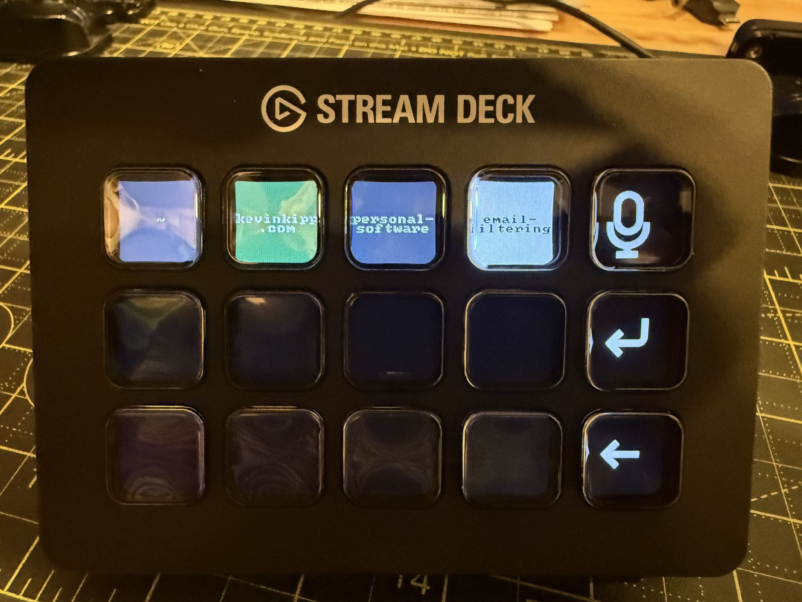

---
{
  "title": "Stream Deck for my coding agents",
  "published": "2026-11-02T17:54:00-06:00",
}
---

My dad bought me a Stream Deck for my birthday, so naturally I've turned it into a status indicator
and switchboard for my coding agents.

Got this dialed in, and it's awesome!

It shows agent status, which agent is focused, and if I press and hold an agent it will voice dictate
until I let go and then submit.

I feel like I can already tell that keeping track of which agent is doing what is going to be much easier with some muscle memory!
